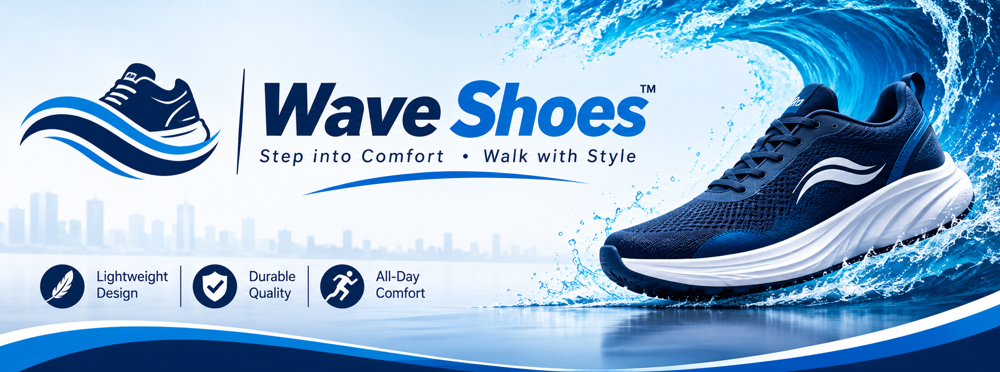

# Wave Shoes Sales Analytics | Google Data Studio

## Project Overview

An interactive sales analytics dashboard developed using Google Data Studio (Looker Studio) to analyze Wave Shoes' sales performance, product demand, customer purchasing behavior, and geographical sales distribution.

The dashboard transforms raw transactional data into meaningful business insights through KPIs, interactive filters, comparative visualizations, and monthly sales trends.

## Dataset Overview

The dataset contains retail sales transaction details with the following attributes:

| Column | Description |
|---|---|
| Order Number | Unique order identifier |
| Order Date | Date of transaction |
| Customer Name | Customer information |
| City | Customer city |
| State | Customer state |
| Order Type | On Shop / other order types |
| Product | Shoe product name |
| Category | Product category |
| Cost Per Unit | Unit purchase cost |
| Selling Price/Unit | Unit selling price |
| Quantity | Units purchased |
| Cost | Total product cost |
| Sales Amount | Total transaction sales |

## Dashboard Highlights

### Key Performance Indicators (KPIs)
- **Total Sales Amount:** 113.33M
- **Total Cost:** 71.23M
- **Total Quantity:** 24.05K
- **Total Transactions:** 7.83K
- **Maximum Sales:** 42.00K

### Interactive Filters
- Category
- State
- Product
- Order Type
- Customer Name

### Visualizations

1. **Sales by Category:** Donut chart comparing Casual, Formal, and Semi-Casual sales distribution.
2. **Product Sales vs Cost:** Comparative analysis of sales amount and cost across shoe products.
3. **Top 5 States by Profit:** Identifies the highest-performing states based on profit.
4. **Geographical Sales Distribution:** Map visualization showing sales distribution across geographical locations.
5. **Monthly Sales Trend:** Tracks monthly sales performance and identifies fluctuations throughout the year.

## Key Business Insights

- Casual footwear contributes approximately 48.9% of the category distribution.
- Formal footwear accounts for 41.4%, while Semi-Casual contributes 9.7%.
- Single Monk shoes generate the highest sales among the displayed products.
- Uttar Pradesh and West Bengal lead the displayed state-wise profit ranking.
- Monthly sales performance fluctuates, with March recording the highest displayed monthly sales of approximately 20.9M.
- Interactive filters enable detailed analysis across products, customers, states, and order types.

## Tools & Technologies

- **Google Data Studio / Looker Studio** – Interactive dashboard development.
- **CSV / Google Sheets** – Dataset management and data source.
- **Data Visualization** – KPI cards, bar charts, donut charts, geographical maps, and time-series analysis.
- **Calculated Fields** – Business metrics and analytical calculations.

## Skills Demonstrated

- Exploratory Data Analysis (EDA)
- Sales Performance Analysis
- Customer Segmentation
- Product Performance Analysis
- Geographical Data Analysis
- KPI Development
- Interactive Dashboard Design
- Business Intelligence & Data Storytelling

## Dashboard Preview

## How to Explore

1. Clone this GitHub repository.
2. Download and open the dashboard PDF to explore the visualizations.
3. Access the underlying dataset for further analysis.
4. Use the interactive dashboard link (if publicly shared) to explore filters and visualizations.

---

**Project Category:** Data Analytics | Business Intelligence | Google Data Studio

**Author:** Dhanush Kumar
